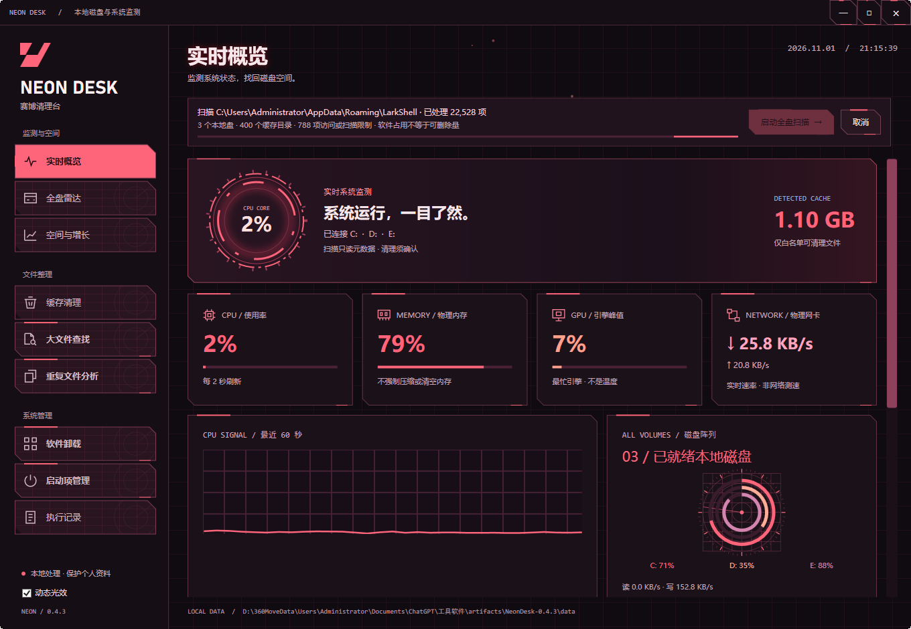
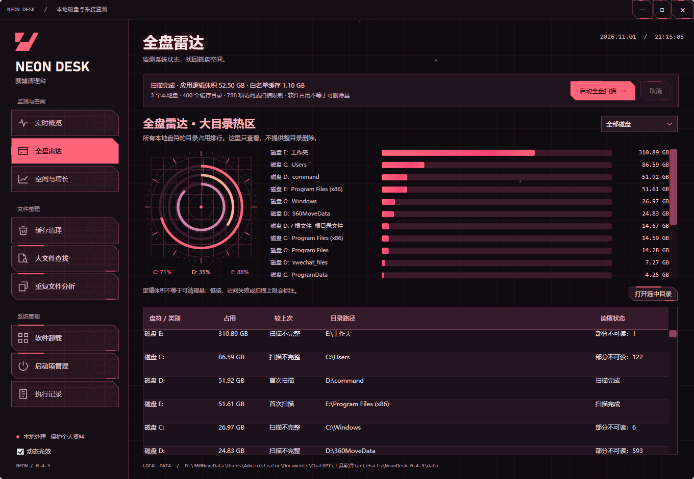

<div align="center">


**磁盘空间失联？接入你的绯红控制台。**

> `SCAN → INSPECT → SELECT → CLEAN`
> 扫描不是删除。先看证据，再下指令。

`WINDOWS 10/11 x64` · `.NET 10 / WPF` · `LOCAL FIRST` · `MIT`

[界面预览](#界面预览) · [功能矩阵](#功能矩阵) · [构建运行](#构建运行) · [清理边界](#清理边界)

</div>

## 接入控制台 · SYSTEM ONLINE

Neon Desk（赛博清理台）是一款 Windows 本地监测与磁盘整理工具。暗红网格、切角面板、动态仪表和磁盘圆环，把系统状态与空间占用放到同一个控制台。

它先展示证据，再由你决定清理哪些缓存。扫描结果留在本机，无需云端账号。

## 界面预览

以下为用户提供并留档的 **0.4.3 实机画面**；包含当时的真实数据，不能视为其他电脑的性能或清理效果承诺。当前源码版本为 **0.5.4**：暗红配色保留，普通导航使用雷达网格，选中导航与主操作使用局部电路纹理。

### 实时概览 / LIVE SIGNAL



CPU、物理内存、GPU 最忙引擎、网络收发与磁盘容量，持续刷新。圆环显示磁盘已用比例，旋转扫描线仅为装饰。驱动没有提供的指标显示不可用。

### 全盘雷达 / VOLUME RADAR



看清各盘顶层目录排行、逻辑体积与读取状态。权限不足、目录链接或扫描上限会明确标记；**软件占用不等于可清理量**。

## 模块装载 · MODULE MATRIX

| 模块 | 做什么 | 操作边界 |
| --- | --- | --- |
| 实时概览 | 约每 2 秒刷新 CPU、内存、GPU、网络与磁盘状态 | 不伪造温度、风扇或压力指标 |
| 全盘雷达 | 统计已就绪固定盘、可移动盘的目录占用 | 不扫描网络盘，不自动删除大目录 |
| 缓存清理 | 识别 Codex、飞书、剪映、豆包、WPS 和部分下载、着色器缓存 | 默认不勾选；按精确白名单逐文件核对 |
| 大文件查找 | 查找 ≥100 MB 文件，展示最大的 1000 项 | 只分析、打开位置 |
| 重复文件分析 | 对 ≥1 MB 同体积文件计算 SHA-256，按相同内容分组 | 同组不等于可删除，不自动保留或删除副本 |
| 空间与增长 | 对比前后扫描，定位增长来源 | 首次扫描建立基线，不完整结果不算增长 |
| 软件管理 | 读取桌面软件和当前用户打包应用，查看登记大小、版本与最近观察到运行时间 | 登记大小非实测；未知历史不推断；卸载转到 Windows 确认流程 |
| 执行记录 | 查看清理摘要与当前日志 | 数据保留数量有上限 |

## 构建运行

环境：Windows 10/11 x64、.NET 10 SDK。运行已发布的轻量包需要 .NET 10 Windows Desktop Runtime。

```powershell
dotnet restore NeonDesk.csproj
dotnet run --project NeonDesk.csproj
# 发布轻量版
dotnet publish NeonDesk.csproj -c Release --self-contained false -o publish
```

解压发布包后运行 `NeonDesk.exe`，也可使用启动脚本。保留完整程序目录。`data` 保存本地扫描基线和清理摘要，不属于应上传的源代码。

## 操作路径

1. 打开工具，先查看实时状态。
2. 点击“启动全盘扫描”，等待目录统计与白名单缓存识别。该步骤不删除文件。
3. 在“缓存清理”按软件或目录查看候选项。退出相关软件后重新扫描，可减少占用跳过。
4. 勾选要清理的项目，核对路径和预计体积，再确认执行。
5. 大文件和重复文件通过各自入口单独分析。

## 安全协议 · CLEAN WITH BOUNDARIES

- 不把聊天、文档、素材、剪映草稿、登录数据库或未知大文件按名称当成垃圾。
- 索引、下载和着色器缓存通常保留最近七天；具体以该行规则提示为准。
- 跳过目录链接、不可访问文件、运行中的对应软件，以及扫描后变化的文件。
- 清理经确认后永久删除；取消只能停止后续操作，不能恢复已删文件。
- 逻辑体积可能受硬链接、压缩、权限等影响，不保证等于磁盘实际可释放空间。
- 普通权限运行即可；不自动提权、关闭防护、结束其他进程或修改清理范围。

## 当前状态

项目处于预览阶段。Windows/驱动/第三方软件版本会影响监测计数器和缓存兼容性。已记录的本机验证见 `docs/verification-0.3.3.md`；这不代表全面兼容性测试。

## 参与与许可

欢迎通过 Issue 提交复现步骤、Windows 版本、软件版本和已脱敏的截图；请勿提交聊天内容、账号、凭据或完整本机扫描数据。采用 MIT License，见 [LICENSE](LICENSE)。

## 软件使用记录

清理台运行时约每 30 秒观察一次可访问进程的可执行文件路径与时间，只在本机 data/observed-app-usage.json 保存最近最多 3000 个路径。不会读取命令行、窗口标题或文档内容。软件页将安装目录/程序路径与观察记录匹配；共同目录可能影响归属，不作为完整的历史最后使用时间。未观察到的项目显示未知，不能据此认定长期未使用。打包应用登记读取可能受权限和系统组件影响，失败会提示。


